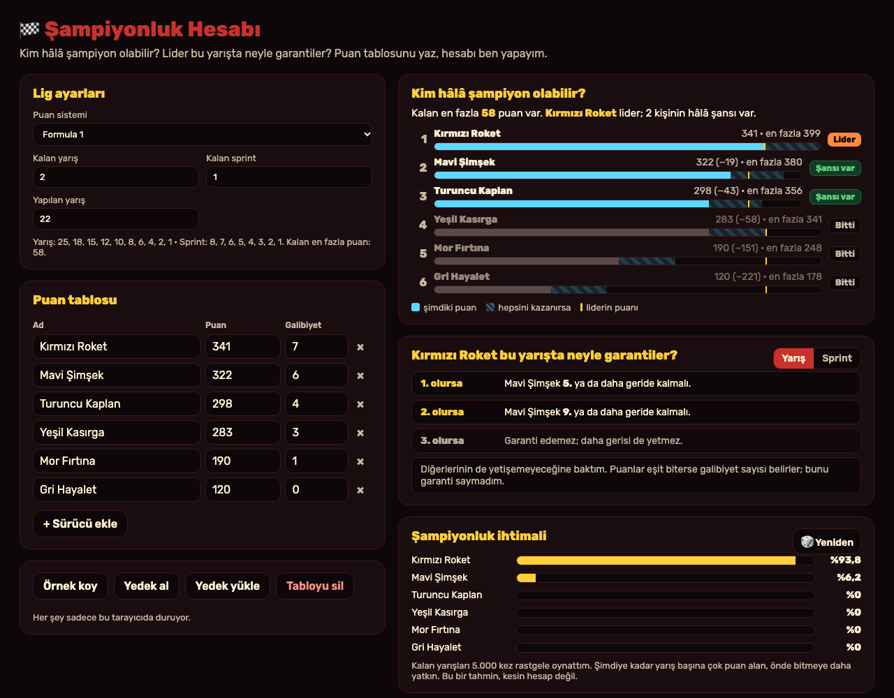
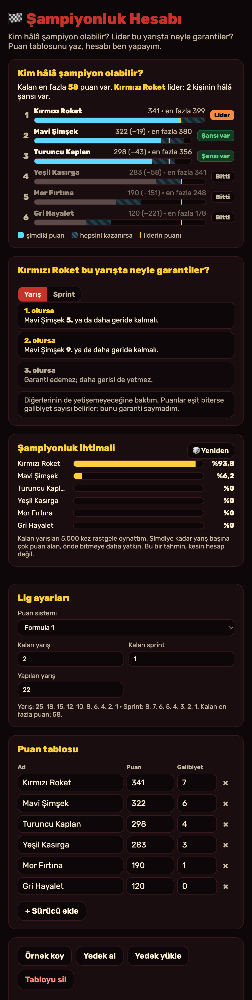

# Şampiyonluk Hesabı

Aklıma bu geldi: Bugün Reddit'te Kimi Antonelli'nin 20 yaşında 2026 Formula 1 Dünya Şampiyonu olduğunu, tarihin en genç şampiyonu olduğunu okudum. Sezonun son yarışlarında hep aynı sorular sorulur: "Kim hâlâ matematiksel olarak şampiyon olabilir?", "Lider bu hafta kaçıncı olursa şampiyonluğu garantiler?" Ben de bunları kâğıtta hesaplarken hep bir şeyi unutuyorum: üçüncü sıradaki sürücüyü ya da sprint yarışını. Ben bu aracı bunun için yaptım. Puan tablosunu yazıyorum, hesabı araç yapıyor. Formula 1, MotoGP ya da kendi okul/oyun ligim için kullanabiliyorum. Bu iki resim, benim çalıştırdığım uygulamanın gerçek ekranları.

## Ben nasıl kullanıyorum?

1. Ben bu klasörde `python3 -m http.server 8000` çalıştırıyorum. Sonra `http://localhost:8000` açıyorum.
2. Ben **Lig ayarları** kısmında puan sistemini seçiyorum: Formula 1, MotoGP ya da **Kendi ligim**. Kendi ligimde puanları "10, 8, 6, 5…" diye kendim yazıyorum.
3. Ben kalan yarış ve sprint sayısını, şimdiye kadar kaç yarış yapıldığını yazıyorum.
4. Ben **Puan tablosu** kısmına sürücüleri, puanlarını ve galibiyet sayılarını yazıyorum.
5. Ben **Kim hâlâ şampiyon olabilir?** kartında her sürücünün durumunu görüyorum: **Lider**, **Şansı var**, **Ancak eşitlik**, **Bitti** ya da **🏆 Şampiyon**. Çubukta şimdiki puan, hepsini kazanırsa ulaşacağı puan ve liderin çizgisi var.
6. Ben **Lider bu yarışta neyle garantiler?** kartında şunu görüyorum: "1. olursa → rakip 5. ya da daha geride kalmalı", "3. olursa → garanti edemez". Sprint için ayrı bir sekme var.
7. Ben **Şampiyonluk ihtimali** kartında kalan yarışların 5.000 kez rastgele oynatılmış hâlini görüyorum. 🎲 düğmesiyle yeniden oynatabiliyorum.
8. Ben **Yedek al** ile tabloyu JSON olarak indiriyorum, **Yedek yükle** ile geri alıyorum.

Ben "Örnek koy" ile hemen deneyebiliyorum. **Örnekteki sürücüler ve puanlar uydurma**; gerçek bir sezon değil.

## Ben içeride ne yaptım?

**Kimin şansı var?** Kalan bütün yarış ve sprintleri kazanırsa bir sürücünün alabileceği en fazla puanı hesaplıyorum. Bu puan liderin şimdiki puanını geçiyorsa şansı var. Gazetelerdeki "matematiksel şans" da bu demek.

**Eşitlik ihtimali.** Bir sürücü en iyi ihtimalle lidere ancak eşitlenebiliyorsa, bunun için liderin hiç puan almaması gerekir. O zaman galibiyet sayısına bakılır. Ben bu yüzden "kalan bütün yarışları kazansa bile liderin galibiyet sayısına yetişebilir mi?" diye de bakıyorum. Örnekteki Yeşil Kasırga puanda eşitlenebiliyor ama 3 + 2 = 5 galibiyet, liderin 7 galibiyetine yetmiyor. Bu yüzden durumu **Bitti**. İlk denememde araç ona "Ancak eşitlik" diyordu; bunu düzelttim.

**Garanti tablosu.** Lider bu yarışta 1., 2., 3. … olursa, en yakın rakip en iyi kaçıncı olursa yine de şampiyonluk kesinleşir? Bunu her sıra için deniyorum. Sadece ikinciye değil, herkese bakıyorum. Lider ve rakip iki yeri aldıktan sonra kalan en iyi yeri, diğer sürücülerin her birinin ayrı ayrı alabileceğini varsayıyorum. Çünkü bir garanti, onlardan hangisi o yeri alırsa alsın bozulmamalı. Puanlar eşit biterse galibiyet belirlediği için ben eşitliği garanti saymıyorum; liderin kesin önde olması gerekiyor.

**Simülasyon.** Her sürücünün gücünü şimdiye kadarki yarış başı puanından hesaplıyorum. Her yarışta sıralamayı **Plackett-Luce** yöntemiyle çekiyorum: önce birinciyi gücüne göre rastgele seçiyorum, sonra kalanlardan ikinciyi, böyle devam ediyor. Güçlü olan önde bitmeye daha yatkın ama kesin değil. Tabloda olmayan sürücüler de yarışıyor (toplam 20 kişi), yoksa listedeki birkaç kişi bütün puanları paylaşırdı. Rastgele sayıları tohumlu bir üreteçle (xorshift) yapıyorum, böylece aynı tohum hep aynı sonucu veriyor.

Ben `core.mjs` içinde hesapları, `app.mjs` içinde ekranı tuttum. Hiçbir sunucu, hesap ya da API anahtarı kullanmıyorum.

## Ben neyi sınadım?

Ben `node test.mjs` komutunu çalıştırdım. **48 kontrol** geçti.

- F1'de 2 yarış ve 1 sprint kalınca en fazla 58 puan, MotoGP'de 1 yarış ve 1 sprint kalınca 37 puan çıktı.
- 1 yarış kala 26 puan önde olan lider şampiyon sayıldı; tam 25 puan önde olan sayılmadı, çünkü eşitlik ihtimali var.
- Garanti tablosunu elle de kontrol ettim. Örnekte lider yarışı kazanırsa 341 + 25 = **366**. Rakip 5. olursa 322 + 10 = 332, kalan 33 puanla en fazla **365** yapar. Yani yetişemez. Rakip 4. olursa 367'ye çıkabileceği için garanti olmuyor. Araç da tam olarak "rakip 5. ya da daha geride" dedi.
- Garanti hesabını, diğer sürücülerin **bütün olası sıralamalarını tek tek deneyen** yavaş bir yöntemle karşılaştırdım. Rastgele üretilmiş 60 lig durumunda 2.000'den fazla senaryonun hepsinde iki yöntem aynı cevabı verdi.
- Simülasyonda olasılıkların toplamı 1 çıktı. Aynı tohum aynı sonucu verdi. Matematiksel olarak "Bitti" denen herkes %0 çıktı. Şampiyonluğu kesinleşmiş lider %100 çıktı.

İlginç bir şey gördüm. Örnekte Turuncu Kaplan'ın matematiksel olarak hâlâ şansı var, ama simülasyonu **200.000 kez** oynattığımda bir kez bile şampiyon olamadı. Bunun için kalan iki yarışı ve sprinti kazanması, liderin ise neredeyse hiç puan alamaması gerekiyor. "Şansı var" ile "olabilir" aynı şey değil.

Ben uygulamayı tarayıcıda da açtım. Yarış ve sprint sekmeleri, kalan yarışı 1 yapınca garanti tablosunun değişmesi, ikincinin puanını düşürünce "🏆 Şampiyon" yazması, kendi puan listemi yazma ve yanlış listeyi ("3, 5" gibi artan) kırmızıyla gösterme çalıştı. Sürücü adına `<b>` yazınca HTML olarak değil düz yazı olarak göründü. Telefon boyutunda (375 piksel) sayfa yana taşmadı.

Benim sınırlarım var. Eşitlik durumunda sadece galibiyet sayısına bakıyorum; gerçek kurallarda sonra ikincilik sayısı gibi başka şeylere de bakılır. Ceza puanları, iptal edilen yarışlar ve takımlar şampiyonası yok. Simülasyon sadece geçmiş puanlara bakıyor; araç değişikliği, kaza ya da hava durumu bilmiyor. O yüzden ihtimal bir tahmin, kesin hesap değil.

## Ben bunları nereden öğrendim?

- Formula 1 ve MotoGP puan tabloları: iki şampiyonanın resmî kurallarındaki yarış ve sprint puanları.
- Plackett-Luce modeli: sıralamaları olasılıkla modellemenin bilinen bir yolu. Ben en basit hâlini kullandım.
- Xorshift rastgele sayı üreteci: George Marsaglia, "Xorshift RNGs", *Journal of Statistical Software*, 2003.

## Ben bugünün kaynaklarına nasıl baktım?

Ben 2 Kasım 2026 saat 13.48 Türkiye vaktinde [GitHub Trending günlük listesine](https://github.com/trending?since=daily) baktım. Gördüğüm 16 repo arasında ilk sıradaki repo "bugün 1.526 yıldız" almıştı. Konusu benim projemle ilgili olmadığı için adını buraya yazmadım. Bu, bütün GitHub'ın kesin birincisi olduğu anlamına gelmez. Ben hiçbir reponun kodunu kopyalamadım.

Ben aynı anda [Trends24 dünya listesinde](https://trends24.in/) ilk sırada bir Japonca müzik programı etiketi (`#CDTVライブライブ`) gördüm. Projeme zorla eklemedim. Bu liste üçüncü taraf bir anlık görünümdür; bütün günün kesin en çok konuşulan konusu demem.

Ben [Reddit r/popular Top/Today listesinde](https://www.reddit.com/r/popular/top/?t=day) ilk sırada r/MadeMeSmile'daki [Marvel temalı Cadılar Bayramı kostümü gönderisini](https://www.reddit.com/r/MadeMeSmile/comments/1xl3mry/marvel_for_halloween_but_your_wife_is_8_months/) gördüm. Aynı listede r/formula1'de ["Kimi Antonelli wins the 2026 Formula One World Drivers' Championship…"](https://www.reddit.com/r/formula1/comments/1xlgcoh/kimi_antonelli_wins_the_2026_formula_one_world/) gönderisi vardı. Benim fikrim buradan çıktı. Bu tek görünüm, bütün Reddit'in en çok konuşulan konusunu kanıtlamaz.

Ben bu projeyi MIT lisansı ile paylaşıyorum.
